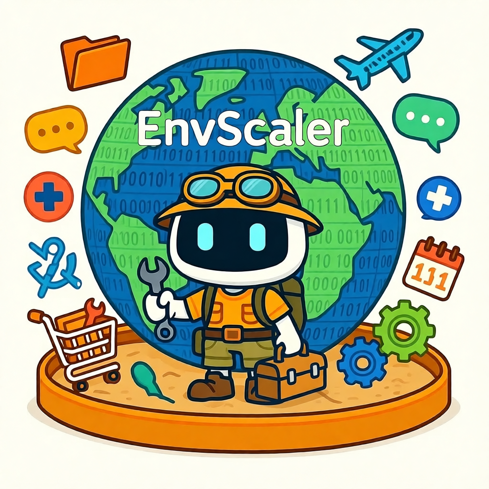
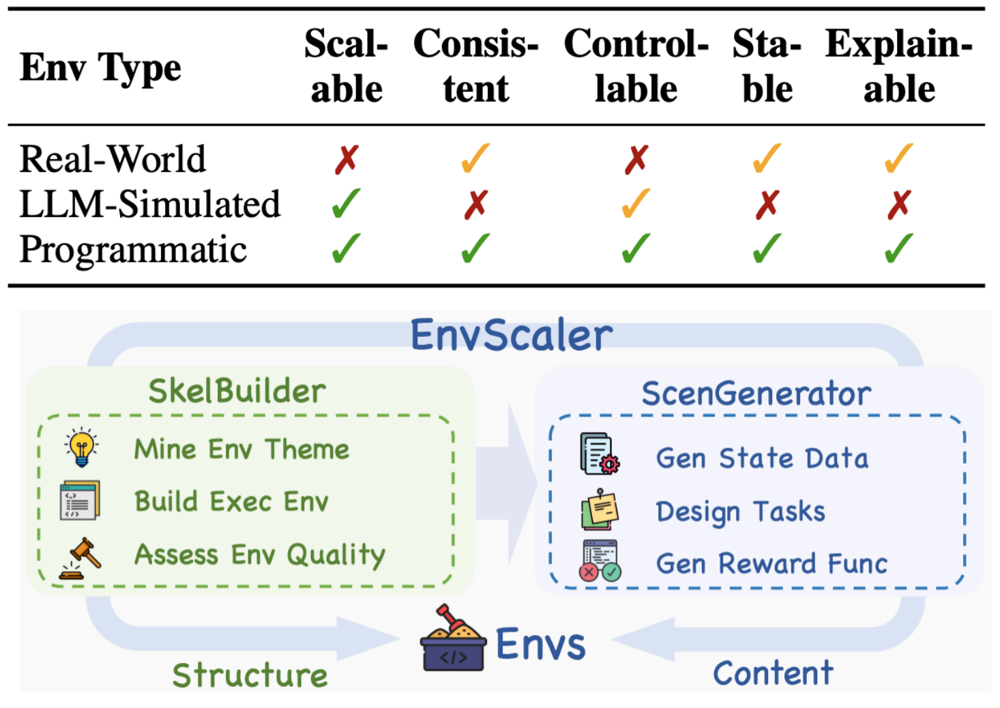
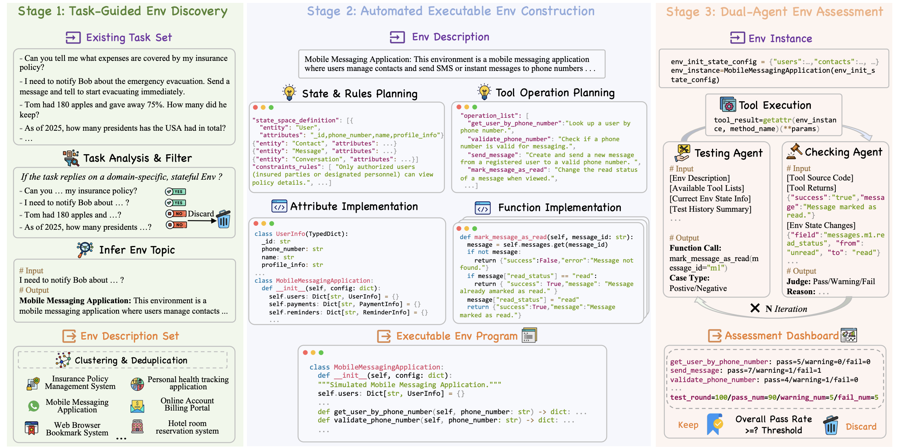
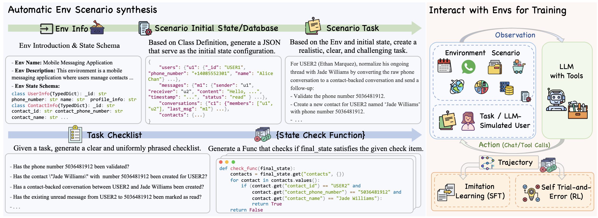
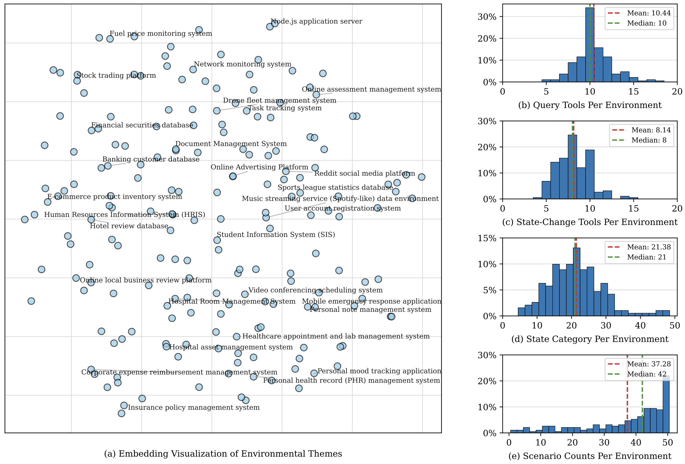
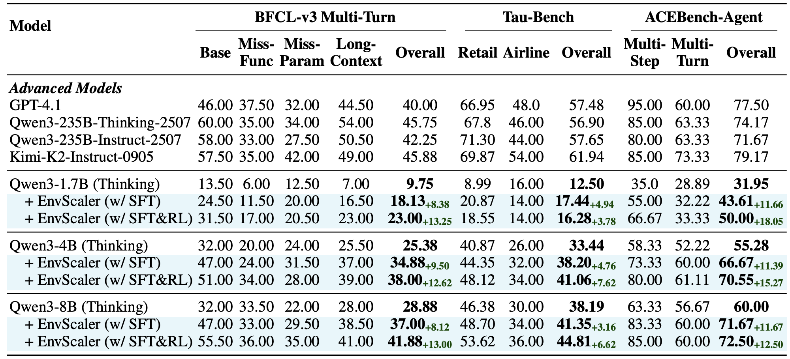

<div align="center">
  
</div>
<h1 align="center"> EnvScaler: Scaling Tool-Interactive Environments for LLM Agent via Programmatic Synthesis</a></h1>


<div align="center">
  <a href="https://arxiv.org/abs/2601.05808">
    
  </a>
  <a href="https://mp.weixin.qq.com/s/1x7H23qkUqh0aahQFiqJzQ">
    
  </a>
  <a href="https://huggingface.co/papers/2601.05808">
    
  </a>
  <a href="https://huggingface.co/collections/XXHStudyHard/envscaler">
    
  </a>
  <a href="https://huggingface.co/collections/XXHStudyHard/envscaler">
    
  </a>
  <a href="https://www.python.org/downloads/release/python-312/">
    
  </a>
</div>

<div align="center">
  <a href="README_ZH.md">中文</a> | <a href="README.md">English</a>
</div>

<h5 align="center"> If you like our project, please give us a star ⭐ on GitHub. We greatly appreciate your support.</h5>


## 📣 Latest News

[Oct 12, 2026]: 🚀 We released Agent-Reflex, teaching language agents to act reflectively under noisy environments. See the [GitHub](https://github.com/RUC-NLPIR/Agent-Reflex).

[Aug 10, 2026]: 🚀 We released Agent-World, evolving general agent intelligence by scaling real-world environments. See the [arXiv](https://arxiv.org/abs/2604.18292) and [GitHub](https://github.com/RUC-NLPIR/Agent-World).

[July 02, 2026]: 🎉 Our paper EnvScaler has been accepted at ACL 2026 Findings!

[Jan 12, 2026]: 📄 Our EnvScaler paper is now available on [arXiv](https://arxiv.org/abs/2601.05808) and [Hugging Face Paper](https://huggingface.co/papers/2601.05808).

[Jan 09, 2026]: 🚀🚀🚀 Full codebase of EnvScaler released, together with the 🤗 [HF models](https://huggingface.co/collections/XXHStudyHard/envscaler) (Qwen3-1.7B, 4B, and 8B) and datasets.


## 🎬 Demo

### Env-Agent-User Interaction
<div align="center">
    <video src="https://github.com/user-attachments/assets/613b46fd-63db-4050-91d2-f7aca2a766e3" />
</div>

### Env-Agent Interaction
<div align="center">
    <video src="https://github.com/user-attachments/assets/b8186257-a22d-4ec1-9ccf-82f6bd23a4b5" />
</div>

### Building Environment From Scratch
<div align="center">
    <video src="https://github.com/user-attachments/assets/fd947e46-014a-41cd-87bb-6744c3dd5b32" />
</div>

To locally run the demo that interacting with Envs:
```bash
cd interact_with_env
python app.py
```
To locally run the demo that builing Envs from scratch:
```bash
cd skel_builder
python env_build_demo.py
```

## 📦 Dataset & Models

We provide EnvScaler’s data and models (after SFT+RL) as follows:

| Data | Link |
| --- | --- |
| 191 Env Metadata | [🤗 HuggingFace](https://huggingface.co/datasets/XXHStudyHard/EnvScaler-191-Env ) |
| 4.7K SFT Scenario | [🤗 HuggingFace](https://huggingface.co/datasets/XXHStudyHard/EnvScaler-SFT-Scenario ) |
| 2.5K RL Scenario | [🤗 HuggingFace](https://huggingface.co/datasets/XXHStudyHard/EnvScaler-RL-Scenario ) |
| 9K SFT Trajectory | [🤗 HuggingFace](https://huggingface.co/datasets/XXHStudyHard/EnvScaler-SFT-Traj-9K ) |
|  |  |

| Model | Link |
| --- | --- |
| EnvScaler-Qwen3-1.7B | [🤗 HuggingFace](https://huggingface.co/XXHStudyHard/EnvScaler-Qwen3-1.7B ) |
| EnvScaler-Qwen3-4B | [🤗 HuggingFace](https://huggingface.co/XXHStudyHard/EnvScaler-Qwen3-4B ) |
| EnvScaler-Qwen3-8B | [🤗 HuggingFace](https://huggingface.co/XXHStudyHard/EnvScaler-Qwen3-8B ) |
|  |  |

## 📑 Contents

- [🎬 Demo](#-demo)
- [📦 Dataset & Models](#-dataset--models)
- [👀 Overview](#-overview)
- [📊 Results](#-results)
- [📁 Project Structure](#-project-structure)
  - [skel_builder/ - Environment Skeleton Construction](skel_builder/README.md)
  - [scen_generator/ - Scenario Generation](scen_generator/README.md)
  - [interact_with_env/ - Agent-Environment Interaction](interact_with_env/README.md)
  - [sft/ - Supervised Fine-Tuning](sft/README.md)
  - [rl/ - Reinforcement Learning](rl/README.md)
  - [evaluation/ - Evaluation Guide](evaluation/README.md)
- [🚀 Quick Start](#-quick-start)
- [📚 Citation](#-citation)
- [📞 Contact](#-contact)


## 👀 Overview

**EnvScaler** is an automated, scalable framework that realizes executable, stateful, tool-interactive environments via programmatic synthesis, for training LLM agents.

<p align="center">
     <br>
  Overview of <b>EnvScaler</b>.
</p>

**SkelBuilder** is the first stage of EnvScaler. It (1) mines potential Env descriptions from existing open-source textual tasks; (2) plans the corresponding state schema and business rules, and generates a fully-functional Python class whose methods expose tool interfaces; (3) performs a dual-agent loop for Env quality inspection (one agent invokes tools, the other checks code, return values, and state changes), guaranteeing quality and consistency.

<p align="center">
     <br>
  Framework of <b>SkelBuilder</b>.
</p>

**ScenGenerator** is the second stage for synthesizing multiple Env scenarios. Given an Env skeleton, it first prompts LLMs to generate an initial state/database, then creates a challenging task that can be solved from that state. Finally, it decomposes the task into checklists, and converts each checkpoint into a Python Boolean function over the final state of the Env, providing rule-based, verifiable reward signals.
 
<p align="center">
     <br>
  Framework of <b>ScenGenerator</b>.
</p>

## 📊 Results

With EnvScaler, we synthesized 191 environments and
about 7K scenarios, and applied them to Supervised Fine-Tuning (SFT) and Reinforcement
Learning (RL) for Qwen3 series models. Results on three benchmarks show that EnvScaler
significantly improves LLMs' ability to solve
tasks in complex environments involving multiturn, multi-tool interactions.

<p align="center">
     <br>
  Statistics of 191 synthesized environments.
</p>

<p align="center">
     <br>
  Performance comparison.
</p>

## 📁 Project Structure

```
EnvScaler/
├── skel_builder/              # Stage 1: Env Skeleton Construction
├── scen_generator/            # Stage 2: Scenario Generation
├── interact_with_env/         # Agent-Env Interaction
├── sft/                       # Supervised Fine-Tuning (SFT)
├── rl/                        # Reinforcement Learning (RL)
└── evaluation/                # Evaluation Guide
```

### Module Description

> 💡 **Tip**: We provide detailed documentation under each module.

1. **[skel_builder/](skel_builder/README.md)** – Env skeleton construction framework that automatically generates executable environment classes from existing tasks.
2. **[scen_generator/](scen_generator/README.md)** – Scenario generation framework that produces state data, task scenarios, and checkpoint functions for an Env skeleton.
3. **[interact_with_env/](interact_with_env/README.md)** – Agent-Env interaction module supporting (1) collecting training data by interacting with synthesized Envs and (2) benchmark evaluation.
4. **[sft/](sft/README.md)** – Supervised fine-tuning implementation based on LlamaFactory.
5. **[rl/](rl/README.md)** – Reinforcement learning implementation based on the ROLL framework.
6. **[evaluation/](evaluation/README.md)** – Evaluation guide including BFCL, TauBench, and ACEBench.


## 🚀 Quick Start

### 1. Clone the repository

```bash
git clone https://github.com/RUC-NLPIR/EnvScaler 
cd EnvScaler
```

### 2. Install dependencies

```bash
pip install -r requirements.txt
```

> 💡 **Note**: Basic dependencies are included in `requirements.txt`. If you need SFT or RL training, please install extra dependencies following the corresponding sub-project documentation:
> - SFT training: refer to [sft/README.md](sft/README.md) to install LlamaFactory
> - RL training: refer to [rl/README.md](rl/README.md) to install the ROLL framework

### 3. Configure LLM service


#### Option 1: Use OpenAI API

Create a `.env` file in the project root and configure your OpenAI API key:

```bash
# .env
OPENAI_API_KEY=your-openai-api-key-here
OPENAI_BASE_URL=https://api.openai.com/v1 
```

#### Option 2: Use self-hosted model

You can deploy a local model with an OpenAI-compatible inference framework such as [vLLM](https://docs.vllm.ai/en/stable/serving/openai_compatible_server/ ).

**Deploy a model with vLLM:**

```bash
vllm serve your-model-path \
    --host 0.0.0.0 \
    --port 8000 \
    --trust-remote-code
```

> ⚠️ **Important**: Ensure the deployed model service supports **Function Calling (FC) interface**, see [vLLM OpenAI-Compatible Server docs](https://docs.vllm.ai/en/stable/serving/openai_compatible_server/ ) for details.

### 4. Verify configuration

Run the demo to verify your setup:

```bash
# Environment interaction demo
cd interact_with_env
python app.py

# Environment interaction Debug
cd interact_with_env
python run_main_debug.py

# Environment building demo
cd skel_builder
python env_build_demo.py
```

### 5. Start using

Now you can use each module of EnvScaler independently:

- **Build environments**: refer to [skel_builder/README.md](skel_builder/README.md)
- **Generate scenarios**: refer to [scen_generator/README.md](scen_generator/README.md)
- **Collect training data**: refer to [interact_with_env/README.md](interact_with_env/README.md)
- **Model training**: refer to [sft/README.md](sft/README.md) and [rl/README.md](rl/README.md)
- **Evaluation**: refer to [evaluation/README.md](evaluation/README.md)


## 📚 Citation

If you find our work helpful, please consider citing it. We greatly appreciate your support.

```bibtex
@article{song2026envscaler,
  title={EnvScaler: Scaling Tool-Interactive Environments for LLM Agent via Programmatic Synthesis},
  author={Song, Xiaoshuai and Chang, Haofei and Dong, Guanting and Zhu, Yutao and Dou, Zhicheng and Wen, Ji-Rong},
  journal={arXiv preprint arXiv:2601.05808},
  year={2026}
}

@article{dong2026agent,
  title   = {Agent-World: Scaling Real-World Environment Synthesis for Evolving General Agent Intelligence},
  author  = {Dong, Guanting and Lu, Junting and Huang, Junjie and Zhong, Wanjun and
             Liu, Longxiang and Huang, Shijue and Li, Zhenyu and Zhao, Yang and
             Song, Xiaoshuai and Li, Xiaoxi and Jin, Jiajie and Zhu, Yutao and
             Wang, Hanbin and Lei, Fangyu and Luo, Qinyu and Chen, Mingyang and
             Chen, Zehui and Feng, Jiazhan and Wen, Ji-Rong and Dou, Zhicheng},
  journal = {CoRR},
  volume  = {abs/2604.18292},
  year    = {2026},
  url     = {https://arxiv.org/abs/2604.18292}
}
```

## 📞 Contact

For any questions or feedback, please reach out to us at [songxiaoshuai@ruc.edu.cn](songxiaoshuai@ruc.edu.cn).
